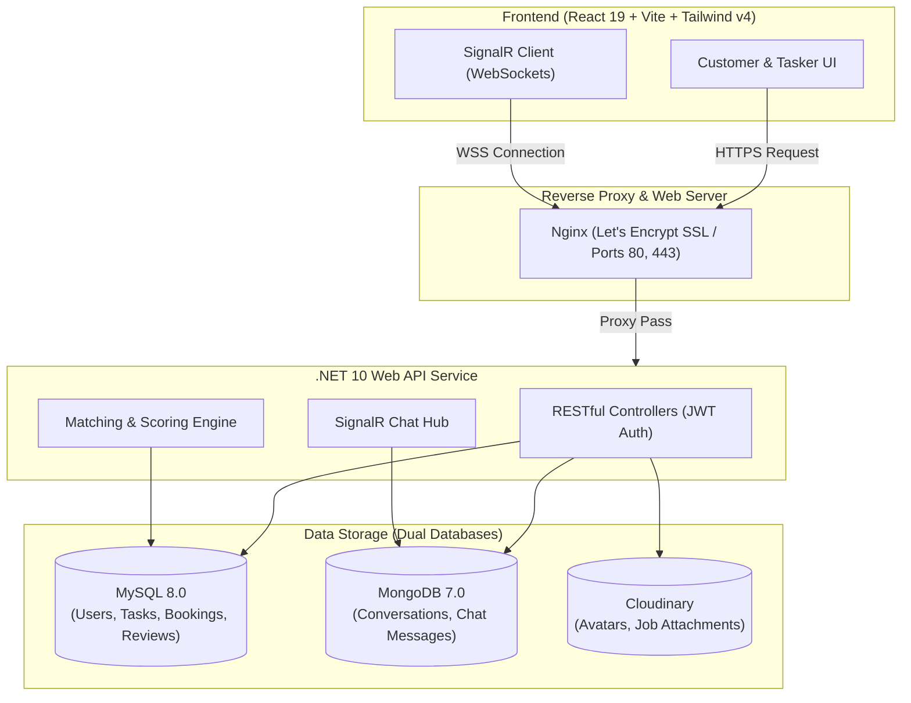

# 🛠️ TaskMate - Smart Marketplace for Home Services & Skilled Taskers

  
  
  
  
  
  

> **TaskMate** is an on-demand gig-economy home services marketplace connecting clients with vetted, skilled taskers (plumbing, electrical repairs, home cleaning, carpentry, and more). Built with a containerized micro-service architecture, dual-database layer (MySQL + MongoDB), real-time WebSockets/SignalR messaging, and an intelligent tasker matching engine.

🌐 **Live Production Demo:** [https://taskmate-vn.duckdns.org](https://taskmate-vn.duckdns.org)

---

## 🌟 Key Features

### 👤 Customer Portal
- **Task Posting & Smart Search:** Post jobs categorized by trade, schedule, location, and estimated budget.
- **Dynamic Filtering & Recommendations:** Filter professionals by proximity, ratings, hourly rates, and real-time availability.
- **Intelligent Matching Algorithm:** Automated tasker recommendation scoring based on a weighted 60% rating / 40% experience formula with automated schedule overlap conflict checks.
- **Booking & Lifecycle Tracking:** End-to-end task state management (Pending -> Accepted -> In Progress -> Completed -> Cancelled).
- **Reviews & Ratings:** Transparent post-completion reviews with verified rating calculations.

### 🧰 Tasker Portal
- **Professional Profiles:** Showcase portfolio images, verified trade skills, hourly rates, and working history.
- **Tasker Dashboard:** Manage job requests, working calendar, schedule availability, and earnings.
- **Order Dispatch Management:** Flexible acceptance, rejection, and progress updates for client bookings.

### 💬 Real-Time Communication & UX
- **Real-Time Chat (SignalR + MongoDB):** Low-latency 1-on-1 instant messaging between clients and taskers; scalable, unstructured chat history persistence via MongoDB.
- **Mobile-First Responsive Design:** Optimized across all viewports (from 360px mobile devices to 4K displays).
- **Security & Identity:** Secure JWT authentication, BCrypt password hashing, and automated OTP password resets via Gmail SMTP.

---

## 🏗️ System Architecture

