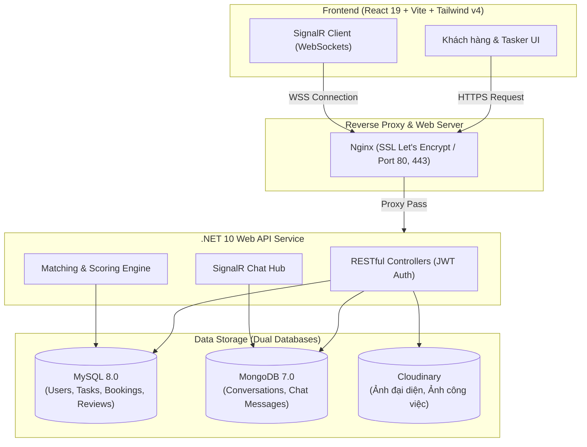

# 🛠️ TaskMate - Nền Tảng Kết Nối Dịch Vụ Gia Đình & Thợ Lành Nghề

  
  
  
  
  
  

> **TaskMate** là nền tảng thương mại dịch vụ tiện ích gia đình (Gig-Economy Marketplace) kết nối khách hàng với các đối tác thợ lành nghề (sửa điện nước, dọn dẹp, lắp ráp nội thất,...). Dự án áp dụng kiến trúc Micro-service/Containerized với hệ cơ sở dữ liệu kép (MySQL + MongoDB), xử lý tin nhắn thời gian thực qua WebSockets/SignalR và thuật toán tính điểm ghép cặp thông minh.

🌐 **Trải nghiệm trực tiếp:** [https://taskmate-vn.duckdns.org](https://taskmate-vn.duckdns.org)

---

## 🌟 Tính Năng Nổi Bật (Key Features)

### 👤 Dành cho Khách Hàng (Customer)
- **Đăng bài & Tìm kiếm thông minh:** Đăng nhu cầu công việc theo danh mục, địa điểm, thời gian và mức giá dự kiến.
- **Bộ lọc & Gợi ý thợ:** Lọc theo khoảng cách, đánh giá sao, mức giá và tình trạng sẵn sàng.
- **Thuật toán Smart Matching:** Tự động đề xuất danh sách thợ phù hợp nhất dựa trên tỷ lệ điểm đánh giá (60%), kinh nghiệm (40%) và tự động loại trừ các thợ đang bị trùng lịch hẹn.
- **Đặt lịch & Theo dõi trạng thái:** Theo dõi trạng thái công việc (Pending -> Accepted -> In Progress -> Completed -> Cancelled).
- **Đánh giá & Xếp hạng:** Viết đánh giá, chấm điểm sao minh bạch sau khi hoàn thành công việc.

### 🧰 Dành cho Đối Tác Thợ (Tasker)
- **Hồ sơ chuyên nghiệp:** Quản lý kỹ năng, kinh nghiệm, bảng giá dịch vụ và hồ sơ cá nhân.
- **Tasker Dashboard:** Xem danh sách việc mới, quản lý lịch làm việc và doanh thu.
- **Tiếp nhận & Xử lý đơn:** Linh hoạt chấp nhận hoặc từ chối đơn đặt lịch theo thời gian rảnh.

### 💬 Thời Gian Thực & Trải Nghiệm Người Dùng (Real-time & UX)
- **Real-time Chat (SignalR + MongoDB):** Nhắn tin trao đổi 1-1 trực tiếp giữa khách hàng và thợ với độ trễ thấp; lưu trữ lịch sử tin nhắn không giới hạn trên MongoDB.
- **Responsive Mobile-First:** Giao diện tối ưu hoàn hảo cho mọi thiết bị (màn hình điện thoại từ 360px đến desktop 4K).
- **Bảo mật & Xác thực:** JWT Authentication, BCrypt mã hóa mật khẩu, OTP khôi phục mật khẩu qua Gmail SMTP.

---

## 🏗️ Kiến Trúc Hệ Thống (Architecture)

